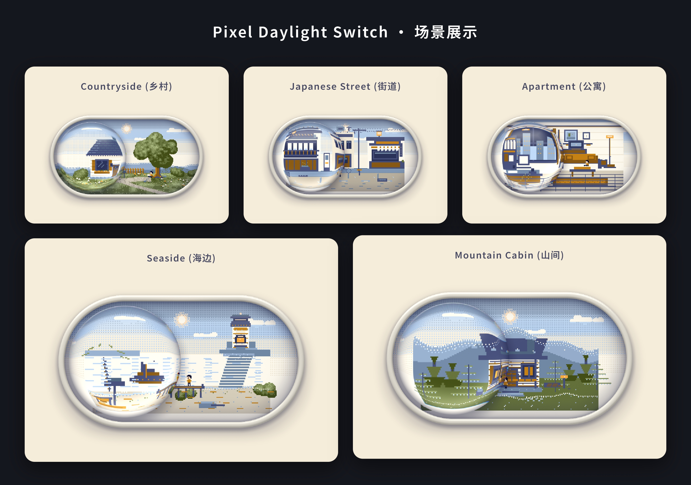

# Pixel Daylight Switch

[](https://github.com/GSvegetable/pixel-daylight-switch/actions/workflows/ci.yml)
[](https://www.npmjs.com/package/pixel-daylight-switch-gsvegetable)
[](LICENSE)

**言語:** [English](README.md) · [简体中文](README.zh-CN.md) · [日本語](README.ja.md)



*屈折するガラススイッチの中に、小さなピクセルワールドを。*

Pixel Daylight Switch は、ドラッグ操作で昼・夕暮れ・夜を切り替えられる UI コンポーネントです。ガラスレンズの中のピクセルアートの世界が、スイッチの動きに合わせて変化します。Vanilla JavaScript、WebGL2、Canvas 2D フォールバックで構成され、実行時にサードパーティ製ライブラリを必要としません。

**[ライブデモ](https://gsvegetable.github.io/pixel-daylight-switch/)** · **[パラメーター Playground](https://gsvegetable.github.io/pixel-daylight-switch/playground.html)** · **[npm パッケージ](https://www.npmjs.com/package/pixel-daylight-switch-gsvegetable)**

## 目的別リンク

| 目的 | リンク |
| --- | --- |
| スイッチを体験する | [ライブデモ](https://gsvegetable.github.io/pixel-daylight-switch/) |
| シーンや表示を調整する | [パラメーター Playground](https://gsvegetable.github.io/pixel-daylight-switch/playground.html) |
| コンポーネントを見る | [Preview](https://gsvegetable.github.io/pixel-daylight-switch/preview.html) |
| Web サイトに埋め込む | [embed.js](embed.js) |
| JavaScript プロジェクトで使う | [npm](https://www.npmjs.com/package/pixel-daylight-switch-gsvegetable) |
| React / Vue の導入例 | [フレームワーク統合ガイド](INTEGRATIONS.md) |
| 実装を読む | [app.js](app.js) · [style.css](style.css) |
| モバイルビルド | [ビルド情報](builds/README.md) · [GitHub Actions](https://github.com/GSvegetable/pixel-daylight-switch/actions/workflows/mobile-build.yml) |
| テスト結果 | [CI ワークフロー](https://github.com/GSvegetable/pixel-daylight-switch/actions/workflows/ci.yml) |
| 更新履歴 | [CHANGELOG](CHANGELOG.md) |
| 不具合を報告する | [Issues](https://github.com/GSvegetable/pixel-daylight-switch/issues) |

## 主な機能

- 田園風景、日本の街並み、モダンなアパート、海辺の灯台、山小屋の 5 シーン。
- WebGL2 によるガラスの屈折表現。利用できない場合は Canvas 2D にフォールバック。
- ドラッグ、タップ、クリック、キーボードによる操作。
- 動き、慣性、バウンス、屈折、ガラス表現、ワールド速度、天候、シーンをカスタマイズ可能。
- 1 ページに複数の独立したインスタンスを配置可能。
- switch セマンティクス、状態通知、`prefers-reduced-motion` に対応。
- 動的なアプリケーション向けに `mount()` と `unmount()` を提供。
- ドキュメントが非表示、またはコンポーネントが画面外にある場合は描画を一時停止。

## クイックスタート：ブラウザーで使用

HTML にマウント要素を配置し、ランタイムを読み込みます。

```html
<div data-ld-part="toggle-daylight" style="width: min(100%, 800px);">
</div>

<script defer src="https://gsvegetable.github.io/pixel-daylight-switch/app.js"></script>
```

ブラウザーランタイムがマウント要素を検出し、コンポーネント UI を生成します。マウント要素には有効な幅を指定してください。

### 1 つのスクリプトで埋め込む

表示したい位置に次のスクリプトを追加します。

```html
<script src="https://gsvegetable.github.io/pixel-daylight-switch/embed.js"></script>
```

レスポンシブな既定シーンのインスタンスを 1 つ作成してランタイムを読み込みます。スタイルはコンポーネント内に限定され、ホストページの `body` や `main` などのグローバル要素を変更しません。シーン、天候、複数インスタンス、配置をカスタマイズする場合は、上記のマウント方式を使用してください。

## npm からインストール

```bash
npm install pixel-daylight-switch-gsvegetable
```

**ES Modules**

```js
import PixelDaylightSwitch from 'pixel-daylight-switch-gsvegetable';

const root = document.querySelector('[data-ld-part="toggle-daylight"]');
PixelDaylightSwitch.mount(root);

// DOM から root を削除する前に呼び出します。
PixelDaylightSwitch.unmount(root);
```

**CommonJS**

```js
const PixelDaylightSwitch = require('pixel-daylight-switch-gsvegetable');
```

ESM と CommonJS の両方を提供します。SSR 環境でもインポートできますが、`mount()` はブラウザー上で対象要素が存在してから呼び出してください。

## 設定属性

すべて任意の設定で、マウント要素に指定します。省略時または無効な値の場合はデフォルト値が使われます。

| HTML 属性 | デフォルト | 説明 |
| --- | ---: | --- |
| `data-speed` | `9.5` | スイッチの基本応答速度。0 より大きい値。 |
| `data-refraction` | `1.24` | ガラスレンズの屈折強度。0 より大きい値。 |
| `data-bezel` | `0.046` | ガラスの縁の相対的な厚さ。0 より大きい値。 |
| `data-start-night` | `false` | 文字列 `"true"` の場合、夜の状態から開始。 |
| `data-friction` | `0.6` | リリース後の慣性減衰。範囲 `0.1–0.9`。 |
| `data-bounce` | `3.2` | 端での跳ね返り。範囲 `0–12`。 |
| `data-dispersion` | `0.05` | ガラス端の RGB 色分散。範囲 `0–0.25`。 |
| `data-shine` | `0.44` | 昼間のガラスハイライト強度。範囲 `0–1.5`。 |
| `data-time-speed` | `1` | ワールドの時間倍率。範囲 `0–8`、`0` で停止。 |
| `data-weather` | `default` | `default` または `snow`。不明な値は `default` に戻ります。 |
| `data-scene` | `countryside` | `countryside`、`japanese-street`、`apartment`、`seaside`、`mountain-cabin`。 |

例：

```html
<div
  data-ld-part="toggle-daylight"
  data-start-night="true"
  data-scene="seaside"
  data-weather="snow"
  data-time-speed="1.4"
  data-refraction="1.3">
</div>
```

## イベントと状態

ルート要素の CSS カスタムプロパティ `--night` が遷移状態を示します。`0` は昼、`1` は夜、その間の値は遷移中です。

確定した昼夜状態が変化すると、ルート要素からバブリングし Shadow DOM の境界を越える `daylight:change` イベントが発生します。`event.detail.night` は boolean 値です。アニメーションの各フレームでは発生しません。

```js
const root = document.querySelector('[data-ld-part="toggle-daylight"]');

root.addEventListener('daylight:change', (event) => {
  console.log(event.detail.night ? 'Night' : 'Day');
});
```

## 描画・アクセシビリティ・パフォーマンス

- WebGL2 でガラスの屈折を描画し、利用できない場合は Canvas 2D に切り替えます。
- コンテナサイズに合わせて描画領域を調整します。
- ドキュメントが非表示、または画面外の場合は描画を一時停止します。
- キーボード操作、switch セマンティクス、状態通知に対応。
- OS の `prefers-reduced-motion` 設定を尊重します。

実際の性能はブラウザー、GPU、デバイスピクセル比、表示中のインスタンス数によって異なります。

## 開発とテスト

```bash
git clone https://github.com/GSvegetable/pixel-daylight-switch.git
cd pixel-daylight-switch
npm test
```

Chromium のブラウザー回帰テスト：

```bash
npm install --no-save @playwright/test@1.56.1
npx playwright install chromium
npm run test:browser
```

GitHub Actions は Node.js 18、20、22 でパッケージと SSR のチェックを実行し、Chromium の操作・モバイル回帰テストも実行します。[CI の実行結果](https://github.com/GSvegetable/pixel-daylight-switch/actions/workflows/ci.yml) を確認してください。

## Android / iOS

Capacitor 8 アプリには、田園の家、日本の街並み、モダンな部屋、海辺の灯台、山小屋の 5 シーンを切り替えるコントロールと、雪を降らせるオプションを追加しました。共通レンダラーを再利用し、ガラスシェーダーと昼夜のドラッグ操作はそのまま維持します。端末の言語に応じて日本語、簡体字中国語、英語を表示します。縦向きでは縦方向のレイアウト、横向きの幅広い画面ではスイッチとシーン・天気コントロールを左右に配置し、横向きの小型スマートフォンではコンパクトな縦レイアウトに切り替わります。GitHub Actions は Android Debug APK と未署名の iOS Simulator アーカイブを生成します。これらは開発用成果物であり、ストア公開用ではありません。Android APK は Play Store リリースではなく、iOS Simulator 版は実機の iPhone / iPad にはインストールできません。[モバイルビルド情報](builds/README.md) と [ビルドワークフロー](https://github.com/GSvegetable/pixel-daylight-switch/actions/workflows/mobile-build.yml) を参照してください。


### Web ページへの埋め込み

基本的な昼夜スイッチを 1 つ表示するだけなら、依存関係のインストールは不要です。次の 1 行を HTML に貼り付けてください。

```html
<script src="https://gsvegetable.github.io/pixel-daylight-switch/embed.js"></script>
```

レスポンシブなデフォルトシーンのスイッチを自動作成してランタイムを読み込みます。デモページ用スタイルは挿入せず、サイトのグローバルスタイルも変更しません。シーンや天気のカスタマイズ、複数インスタンス、配置の制御には、上記の npm API と `data-scene` / `data-weather` 属性を使用してください。

### 独自の Android / iOS Capacitor アプリへの統合

このリポジトリが現在提供するのは **Capacitor アプリのテンプレートとビルドスクリプト**であり、単独でインストールできるネイティブ UI プラグインではありません。既存の Capacitor 8 プロジェクトには、`mobile/`、`app.js`、`style.css`、`scripts/prepare-mobile.cjs` を統合し、次を実行します。

```bash
npm install
npm run mobile:prepare
npm run mobile:android:init  # Android 初回作成
npm run mobile:android      # 以降の同期
```

iOS は初回に `npm run mobile:ios:init`、以降は `npm run mobile:ios` を実行します（macOS と Xcode が必要です）。`npm run mobile:open:android` / `npm run mobile:open:ios` でネイティブプロジェクトを開けます。正確なスクリプトは [package.json](package.json) を参照してください。

## リポジトリ構成

```text
pixel-daylight-switch/
├── .github/workflows/       # CI、モバイルビルド、npm 公開
├── assets/
│   └── scene-gallery.png    # 5 シーンの一覧画像
├── builds/
│   └── README.md            # モバイル成果物の説明（バイナリは Actions が生成）
├── mobile/
│   ├── index.html            # Capacitor アプリの入口
│   └── mobile.css            # モバイル専用レイアウト
├── scripts/
│   └── prepare-mobile.cjs   # Capacitor 用 Web ランタイム準備
├── tests/
│   ├── browser/              # Playwright 操作・モバイル回帰テスト
│   ├── fixture.html
│   ├── mobile-smoke.cjs
│   ├── package-smoke.cjs
│   └── server.cjs
├── app.js                    # コンポーネント、シーン、入力、描画
├── style.css                 # コンポーネントのスタイル
├── embed.js                  # 1 スクリプト埋め込みローダー
├── index.html                # ライブデモ
├── preview.html              # コンポーネントプレビュー
├── playground.html            # パラメーター Playground
├── index.mjs / index.cjs     # ESM / CommonJS エントリー
├── package.json               # npm メタデータとスクリプト
├── capacitor.config.json     # Capacitor 設定
├── playwright.config.cjs     # ブラウザーテスト設定
├── CHANGELOG.md
├── llms.txt
├── LICENSE
└── README*.md                 # 英語・簡体字中国語・日本語の README
```

## ライセンス

[Unlicense](LICENSE) に基づき公開されています。個人・商用を問わず、帰属表示なしで自由にコピー、変更、公開、配布、利用できます。無保証で提供されます。
