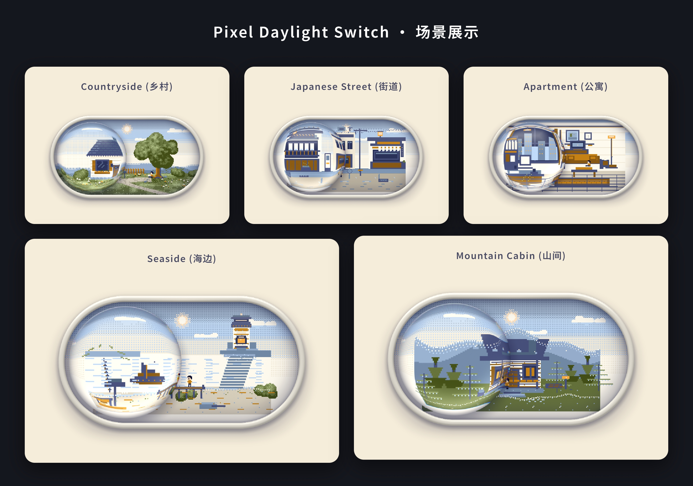

# Pixel Daylight Switch

[](https://github.com/GSvegetable/pixel-daylight-switch/actions/workflows/ci.yml)
[](https://www.npmjs.com/package/pixel-daylight-switch-gsvegetable)
[](https://unlicense.org/)
[](https://developer.mozilla.org/docs/Web/JavaScript)

**Language / 语言 / 言語:** [English](#english) · [简体中文](#简体中文) · [日本語](#日本語)



A tiny animated world, held inside a refractive glass switch.

Pixel Daylight Switch is a self-contained day/night UI component. Drag its glass control to move between day, dusk, and night while a small pixel-art environment changes inside the lens. It is built with vanilla JavaScript, WebGL2, and a Canvas 2D fallback — with no third-party runtime dependencies.

**[Try the live Playground](https://gsvegetable.github.io/pixel-daylight-switch/playground.html)** · **[View the source](https://github.com/GSvegetable/pixel-daylight-switch)** · **[Read the changelog](CHANGELOG.md)**

---

<a id="english"></a>

[English](README.md) · [简体中文](README.zh-CN.md) · [日本語](README.ja.md)

### Highlights

- **A living pixel world:** five handcrafted environments — countryside, Japanese street, modern apartment, seaside lighthouse, and mountain cabin.
- **Refractive glass:** WebGL2 rendering creates the lens effect; Canvas 2D provides a fallback when WebGL2 cannot be initialized.
- **Continuous day/night motion:** drag, tap, click, or use the keyboard to move through the transition.
- **Tunable behavior and appearance:** configure motion, inertia, bounce, refraction, glass details, world speed, weather, and scene through HTML data attributes.
- **Multiple instances:** mount independent switches on the same page.
- **Accessibility-aware interaction:** switch semantics, an announced status, keyboard controls, and support for `prefers-reduced-motion`.
- **Lifecycle control:** explicit `mount()` and `unmount()` methods for dynamic applications.
- **Lightweight integration:** the standalone browser script has no third-party runtime dependencies.

### Try it

Open the **[Interactive Playground](https://gsvegetable.github.io/pixel-daylight-switch/playground.html)** to change the scene and parameters, preview the result, and copy the generated HTML.

### Quick start — no build step

Add an empty mount point and load the browser script:

```html
<div data-ld-part="toggle-daylight"></div>

<script
  defer
  src="https://gsvegetable.github.io/pixel-daylight-switch/app.js">
</script>
```

The script automatically finds elements with `data-ld-part="toggle-daylight"` and creates the component markup and rendering surface. Give the mount point a width in your layout; the component scales to its container.

### Install from npm

```bash
npm install pixel-daylight-switch-gsvegetable
```

**ES modules**

```js
import PixelDaylightSwitch from 'pixel-daylight-switch-gsvegetable';

const root = document.querySelector('[data-ld-part="toggle-daylight"]');

PixelDaylightSwitch.mount(root);

// Before removing the root from the DOM:
PixelDaylightSwitch.unmount(root);
```

**CommonJS**

```js
const PixelDaylightSwitch = require('pixel-daylight-switch-gsvegetable');
```

The package exposes ESM and CommonJS entry points. It is safe to import in an SSR environment; call `mount()` only in the browser after the target element exists. Automatic mounting is provided when the browser runtime is loaded directly.

### Configuration

Every option is optional and is set on the component's root element. The defaults below are used when an attribute is omitted or contains an invalid value.

| Attribute | Default | Description |
| --- | ---: | --- |
| `data-speed` | `9.5` | Base response speed of the switch motion. Must be greater than zero. |
| `data-refraction` | `1.24` | Refraction strength of the glass lens. Must be greater than zero. |
| `data-bezel` | `0.046` | Relative thickness of the glass edge. Must be greater than zero. |
| `data-start-night` | `false` | Set to the exact string `"true"` to start in the night state. |
| `data-friction` | `0.6` | Inertia damping after release; clamped to `0.1–0.9`. |
| `data-bounce` | `3.2` | Edge rebound strength; clamped to `0–12`. |
| `data-dispersion` | `0.05` | RGB dispersion around the glass edge; clamped to `0–0.25`. |
| `data-shine` | `0.44` | Daytime glass highlight intensity; clamped to `0–1.5`. |
| `data-time-speed` | `1` | Pixel-world simulation speed; clamped to `0–8`. Set to `0` to freeze world dynamics. |
| `data-weather` | `default` | `default` or `snow`. Unknown values fall back to `default`. |
| `data-scene` | `countryside` | `countryside`, `japanese-street`, `apartment`, `seaside`, or `mountain-cabin`. |

**Example — start at night with the seaside scene**

```html
<div
  data-ld-part="toggle-daylight"
  data-start-night="true"
  data-scene="seaside"
  data-weather="snow"
  data-time-speed="1.4"
  data-refraction="1.3">
</div>
```

### Events and state

The component exposes its transition progress as the CSS custom property `--night` on the root element:

- `0` — day
- `1` — night
- Values between `0` and `1` — transition in progress

When the committed day/night state changes, the root dispatches a bubbling, composed `daylight:change` event. Its `event.detail.night` property is a boolean.

```js
const root = document.querySelector('[data-ld-part="toggle-daylight"]');

root.addEventListener('daylight:change', (event) => {
  console.log(event.detail.night ? 'Night' : 'Day');
});
```

The event reports a change of the committed day/night state; it is not emitted for every animation frame.

### Rendering and performance

- WebGL2 is used for the refractive glass rendering.
- Canvas 2D is used when WebGL2 is unavailable or initialization fails.
- Rendering is paused when the document is hidden or the component is outside the viewport.
- The component measures its container and scales its drawing surface to fit.
- The component responds to the operating system's `prefers-reduced-motion` setting.

The browser script does not require a framework. Actual rendering performance depends on the browser, graphics hardware, device pixel ratio, and the number of instances on screen.

### Development and tests

```bash
git clone https://github.com/GSvegetable/pixel-daylight-switch.git
cd pixel-daylight-switch
npm test
```

The package smoke tests cover the module entry points, SSR import behavior, and mobile preparation checks.

To run the Chromium browser regression suite:

```bash
npm install --no-save @playwright/test@1.56.1
npx playwright install chromium
npm run test:browser
```

GitHub Actions runs package and SSR checks on Node.js 18, 20, and 22, plus the Chromium interaction and mobile regression suite. See the **[workflow runs](https://github.com/GSvegetable/pixel-daylight-switch/actions/workflows/ci.yml)** for the latest result.

### Mobile builds and validation

The repository includes Capacitor 8 build paths for Android and iOS. The mobile projects reuse the web renderer rather than maintaining a separate rendering implementation.

Build setup and commands are documented in the repository scripts and mobile configuration. Build success should not be interpreted as proof of compatibility on every physical device. Android real-device validation is ongoing; iOS simulator build support is included, but this repository does not provide a signed App Store IPA.

### Project hub

Start here based on what you want to do — no need to browse the repository manually.

| I want to… | Open |
| --- | --- |
| **Try the switch** | [Live interactive demo](https://gsvegetable.github.io/pixel-daylight-switch/) |
| **Tune every visual parameter** | [Parameter Playground](https://gsvegetable.github.io/pixel-daylight-switch/playground.html) |
| **See the component preview** | [Preview page](https://gsvegetable.github.io/pixel-daylight-switch/preview.html) |
| **Embed it on my own website** | [Embed instructions and loader](https://github.com/GSvegetable/pixel-daylight-switch/blob/main/embed.js) |
| **Install it in a JavaScript project** | [npm package](https://www.npmjs.com/package/pixel-daylight-switch-gsvegetable) · `npm install pixel-daylight-switch-gsvegetable` |
| **Read the source code** | [Core renderer](https://github.com/GSvegetable/pixel-daylight-switch/blob/main/app.js) · [Styles](https://github.com/GSvegetable/pixel-daylight-switch/blob/main/style.css) |
| **Download a mobile build** | [Mobile build notes and artifacts](builds/README.md) |
| **See what changed** | [Changelog](CHANGELOG.md) |
| **Check automated test results** | [Quality checks](https://github.com/GSvegetable/pixel-daylight-switch/actions/workflows/ci.yml) |
| **Get Android / iOS build status** | [Native mobile builds](https://github.com/GSvegetable/pixel-daylight-switch/actions/workflows/mobile-build.yml) |
| **Report a bug or request a feature** | [Open an issue](https://github.com/GSvegetable/pixel-daylight-switch/issues/new/choose) |
| **Review license and reuse terms** | [Unlicense](LICENSE) |

**Quick choices:** [Try it now](https://gsvegetable.github.io/pixel-daylight-switch/) · [Customize it](https://gsvegetable.github.io/pixel-daylight-switch/playground.html) · [Install with npm](https://www.npmjs.com/package/pixel-daylight-switch-gsvegetable)

### License

Pixel Daylight Switch is released under **[The Unlicense](https://unlicense.org/)**. You may copy, modify, publish, distribute, and use it for personal or commercial purposes without attribution. The software is provided without warranty; see [LICENSE](LICENSE).

---

<a id="简体中文"></a>
