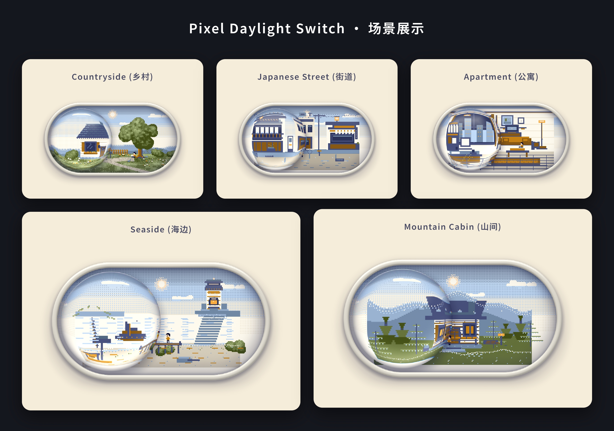

# Pixel Daylight Switch

[](https://github.com/GSvegetable/pixel-daylight-switch/actions/workflows/ci.yml)
[](https://www.npmjs.com/package/pixel-daylight-switch-gsvegetable)
[](LICENSE)

**语言切换：** [English](README.md) · [简体中文](README.zh-CN.md) · [日本語](README.ja.md)



*一个装在折射玻璃开关里的微缩像素世界。*

Pixel Daylight Switch 是一个可拖动的昼夜切换 UI 组件。拖动玻璃开关，可以让内部的像素世界从白天经过黄昏切换到夜晚。项目使用原生 JavaScript、WebGL2 和 Canvas 2D 回退渲染，不依赖第三方运行时库。

**[直接体验在线演示](https://gsvegetable.github.io/pixel-daylight-switch/)** · **[打开参数实验室](https://gsvegetable.github.io/pixel-daylight-switch/playground.html)** · **[npm 安装](https://www.npmjs.com/package/pixel-daylight-switch-gsvegetable)**

## 快速入口

| 你想做什么 | 直接打开 |
| --- | --- |
| 体验昼夜开关 | [在线演示](https://gsvegetable.github.io/pixel-daylight-switch/) |
| 调整场景与视觉参数 | [交互式参数实验室](https://gsvegetable.github.io/pixel-daylight-switch/playground.html) |
| 查看组件预览 | [Preview 页面](https://gsvegetable.github.io/pixel-daylight-switch/preview.html) |
| 用一个脚本嵌入网站 | [嵌入加载器源码](embed.js) |
| 在 JavaScript 项目中使用 | [npm 包](https://www.npmjs.com/package/pixel-daylight-switch-gsvegetable) |
| React / Vue 接入示例 | [框架集成指南](INTEGRATIONS.md) |
| 阅读核心实现 | [运行时 app.js](app.js) · [样式 style.css](style.css) |
| 获取移动端构建 | [构建说明与限制](builds/README.md) · [GitHub Actions 构建任务](https://github.com/GSvegetable/pixel-daylight-switch/actions/workflows/mobile-build.yml) |
| 查看自动化测试 | [CI 工作流](https://github.com/GSvegetable/pixel-daylight-switch/actions/workflows/ci.yml) |
| 查看版本变化 | [更新日志](CHANGELOG.md) |
| 反馈问题 | [GitHub Issues](https://github.com/GSvegetable/pixel-daylight-switch/issues) |

## 功能特点

- 五种场景：乡村、日本街道、现代公寓、海边灯塔和山间木屋。
- WebGL2 折射玻璃效果；WebGL2 不可用或初始化失败时回退到 Canvas 2D。
- 支持连续拖动、点击/触控切换和键盘操作。
- 可配置运动速度、惯性、回弹、折射、玻璃细节、世界速度、天气和场景。
- 同一页面支持多个独立实例。
- 提供 switch 语义、状态播报和 `prefers-reduced-motion` 支持。
- 提供 `mount()`、`unmount()` 生命周期方法，适合动态页面。
- 页面隐藏或组件离开视口时暂停绘制。

## 快速开始：浏览器直接使用，无需构建

在页面中放置挂载节点，并引入运行脚本：

```html
<div data-ld-part="toggle-daylight" style="width: min(100%, 800px);">
</div>

<script defer src="https://gsvegetable.github.io/pixel-daylight-switch/app.js"></script>
```

浏览器运行时会自动查找挂载节点并生成组件界面。请为挂载元素设置可用宽度。

### 使用单脚本嵌入

如果希望脚本自动插入组件，可在希望显示组件的位置添加：

```html
<script src="https://gsvegetable.github.io/pixel-daylight-switch/embed.js"></script>
```

也可以直接在 script 标签上配置场景和天气：

```html
<script src="https://gsvegetable.github.io/pixel-daylight-switch/embed.js" data-scene="seaside" data-weather="snow" data-start-night="true"></script>
```

加载器会自动创建响应式实例并加载运行时。组件样式仅作用于组件本身，不会重置或修改宿主网页的 `body`、`main` 等全局元素。你也可以直接在 script 标签上设置 `data-scene`、`data-weather`、`data-start-night` 等参数。若要创建多个实例或精确控制位置，请使用上面的挂载节点方式。

## 通过 npm 安装

```bash
npm install pixel-daylight-switch-gsvegetable
```

**ES Modules**

```js
import PixelDaylightSwitch from 'pixel-daylight-switch-gsvegetable';

const root = document.querySelector('[data-ld-part="toggle-daylight"]');
PixelDaylightSwitch.mount(root);

// 从 DOM 移除 root 之前调用：
PixelDaylightSwitch.unmount(root);
```

**CommonJS**

```js
const PixelDaylightSwitch = require('pixel-daylight-switch-gsvegetable');
```

npm 包提供 ESM 和 CommonJS 入口，可在 SSR 环境中安全导入；只有在浏览器中且目标元素已经存在时，才能调用 `mount()`。npm 发布文件清单以 [package.json](package.json) 为准。

## 社区场景插件（v3.0.0）

3.0.0 开始支持通过 JSON Manifest 注册自定义像素世界。普通创作者可以保留像素矩阵、只修改昼夜色板；进阶创作者可以自己设计像素矩阵和时间色板。插件只提供声明式数据，不会在渲染器中执行第三方 JavaScript。

**浏览器使用：**

```html
<script src="https://gsvegetable.github.io/pixel-daylight-switch/scene-plugin.js"></script>
<script src="https://gsvegetable.github.io/pixel-daylight-switch/app.js"></script>
<div data-ld-part="toggle-daylight" data-scene="sakura-evening"></div>
<script>
  PixelDaylightSwitch.registerScene(sceneManifest);
</script>
```

请在组件挂载前注册 Manifest。使用 npm 时：

```js
import PixelDaylightSwitch, { registerScene } from 'pixel-daylight-switch-gsvegetable';
import myScene from './my-scene.json';

const unregister = registerScene(myScene);
const root = document.querySelector('[data-ld-part="toggle-daylight"]');
root.dataset.scene = myScene.id;
PixelDaylightSwitch.mount(root);
```

Manifest v1 包含场景 ID、作者与许可证、像素画布、字符像素矩阵、多个昼夜色板和 24 小时时间节点。画布最大为 192 × 112；每个像素符号都必须在每套色板中定义颜色。渲染器会在相邻时间节点之间插值颜色。

- [完整插件开发指南](SCENE_PLUGINS.md)
- [Manifest v1 JSON Schema](schemas/scene-manifest.v1.schema.json)
- [樱花黄昏示例](examples/scenes/sakura-evening.json)

v1 暂不支持外部图片/Sprite、分层 Tile Map 和自定义动画轨道；这些能力会通过后续独立版本的 Schema 扩展，不会开放任意代码执行。五个内置场景仍保留原有绘制与动态逻辑。

## 配置参数

所有参数均为可选项，写在挂载元素上。省略参数或参数值无效时使用默认值。

| HTML 属性 | 默认值 | 说明 |
| --- | ---: | --- |
| `data-speed` | `9.5` | 开关运动的基础响应速度，必须大于零。 |
| `data-refraction` | `1.24` | 玻璃镜片折射强度，必须大于零。 |
| `data-bezel` | `0.046` | 玻璃边缘的相对厚度，必须大于零。 |
| `data-start-night` | `false` | 精确设置为字符串 `"true"` 时，从夜晚状态开始。 |
| `data-friction` | `0.6` | 松手后的惯性阻尼，范围 `0.1–0.9`。 |
| `data-bounce` | `3.2` | 边缘回弹力度，范围 `0–12`。 |
| `data-dispersion` | `0.05` | 玻璃边缘 RGB 色散强度，范围 `0–0.25`。 |
| `data-shine` | `0.44` | 白天玻璃高光强度，范围 `0–1.5`。 |
| `data-time-speed` | `1` | 像素世界时间倍率，范围 `0–8`；设为 `0` 可冻结动态。 |
| `data-weather` | `default` | 支持 `default` 或 `snow`；未知值回退为 `default`。 |
| `data-scene` | `countryside` | 支持 `countryside`、`japanese-street`、`apartment`、`seaside`、`mountain-cabin`。 |

示例：

```html
<div
  data-ld-part="toggle-daylight"
  data-start-night="true"
  data-scene="seaside"
  data-weather="snow"
  data-time-speed="1.4"
  data-refraction="1.3">
</div>
```

## 事件与状态

组件根元素通过 CSS 自定义属性 `--night` 暴露过渡进度：`0` 表示白天，`1` 表示夜晚，中间值表示过渡中。

当已确认的昼夜状态发生变化时，根元素会派发可冒泡、可跨越 Shadow DOM 边界的 `daylight:change` 事件，`event.detail.night` 为布尔值。该事件不会在每一帧动画中触发。

```js
const root = document.querySelector('[data-ld-part="toggle-daylight"]');

root.addEventListener('daylight:change', (event) => {
  console.log(event.detail.night ? '夜晚' : '白天');
});
```

## 渲染、无障碍与性能

- 使用 WebGL2 渲染玻璃折射；不可用或初始化失败时回退到 Canvas 2D。
- 根据容器尺寸调整渲染区域。
- 页面隐藏或组件离开视口时暂停绘制。
- 提供键盘操作、switch 语义和实时状态播报。
- 尊重系统的 `prefers-reduced-motion` 设置。

实际性能取决于浏览器、图形硬件、设备像素比以及同时显示的实例数量。

## 开发与测试

```bash
git clone https://github.com/GSvegetable/pixel-daylight-switch.git
cd pixel-daylight-switch
npm test
```

运行 Chromium 浏览器回归测试：

```bash
npm install --no-save @playwright/test@1.56.1
npx playwright install chromium
npm run test:browser
```

GitHub Actions 会在 Node.js 18、20、22 环境中执行包与 SSR 检查，并运行 Chromium 交互和移动端回归测试。最新状态见 [CI 工作流](https://github.com/GSvegetable/pixel-daylight-switch/actions/workflows/ci.yml)。

## Android 与 iOS

Capacitor 移动端现已提供完整的场景控制界面：可在乡间小屋、日本街道、现代公寓、海边灯塔、山间木屋五个世界之间切换，并可单独开启飘雪效果。切换时复用同一套渲染器，不改动玻璃 Shader 和昼夜拖动交互。界面会根据设备语言显示简体中文、日文或英文。布局同时适配竖屏和横屏：竖屏采用纵向浏览；较宽的横屏将开关放在左侧、场景与天气控制放在右侧；窄屏横向手机则采用更紧凑的单列布局。GitHub Actions 会生成 Android Debug APK 和未签名的 iOS 模拟器应用压缩包。它们属于开发测试产物，不是可直接上架的商店版本：Android APK 不是 Play Store 发布包，iOS 模拟器版本也不能安装到实体 iPhone/iPad。请查看[移动端构建说明](builds/README.md)和[移动端工作流](https://github.com/GSvegetable/pixel-daylight-switch/actions/workflows/mobile-build.yml)。


### 快速嵌入到网页

如果只需要在网页中放入一个昼夜开关，无需安装依赖，直接粘贴下面这一行即可。它会自动加载样式和组件：

```html
<script src="https://gsvegetable.github.io/pixel-daylight-switch/embed.js"></script>
```

这是一键式基础嵌入，会创建响应式的默认场景开关；不会注入演示页面样式，也不会修改网站全局样式。如果需要自定义场景、天气或多个实例，请使用上面的 npm API（`data-scene`、`data-weather` 等参数）。

### 集成到自己的 Android / iOS Capacitor 工程

项目目前提供的是 **Capacitor 应用模板与构建脚本**，不是可直接 `npm install` 的原生 UI 插件。若你的工程已经使用 Capacitor 8，可将本仓库的 `mobile/`、`app.js`、`style.css` 和 `scripts/prepare-mobile.cjs` 集成到工程，再执行：

```bash
npm install
npm run mobile:prepare
npm run mobile:android:init  # 首次创建 Android 工程
npm run mobile:android      # 后续同步更新
```

iOS 首次创建使用 `npm run mobile:ios:init`，后续使用 `npm run mobile:ios`；需要 macOS 与 Xcode。打开原生工程分别执行 `npm run mobile:open:android` 或 `npm run mobile:open:ios`。详细脚本以 [package.json](package.json) 为准。

## 项目 / 目录结构

```text
pixel-daylight-switch/
├── .github/workflows/       # CI、原生移动端构建、npm 发布
├── assets/
│   └── scene-gallery.png    # 五种场景总览图
├── builds/
│   └── README.md            # 移动端产物说明；二进制由工作流生成
├── mobile/
│   ├── index.html            # Capacitor 应用入口
│   └── mobile.css            # 移动端专用布局
├── scripts/
│   └── prepare-mobile.cjs   # 为 Capacitor 准备共用 Web 运行时
├── tests/
│   ├── browser/              # Playwright 交互与移动端回归
│   ├── fixture.html
│   ├── mobile-smoke.cjs
│   ├── package-smoke.cjs
│   └── server.cjs
├── app.js                    # 组件运行时、场景、交互与渲染
├── style.css                 # 组件样式
├── embed.js                  # 单脚本网站嵌入加载器
├── index.html                # 在线演示主页
├── preview.html              # 组件预览
├── playground.html            # 交互式参数实验室
├── index.mjs / index.cjs     # ESM 与 CommonJS 包入口
├── package.json               # npm 元数据与脚本
├── capacitor.config.json     # Capacitor 配置
├── playwright.config.cjs     # 浏览器测试配置
├── CHANGELOG.md
├── llms.txt
├── LICENSE
└── README*.md                 # 英文、简体中文、日文文档
```

## 许可证

项目采用 [Unlicense](LICENSE)。你可以自由复制、修改、发布、分发，并用于个人或商业项目，无需署名。软件按现状提供，不附带任何担保。
